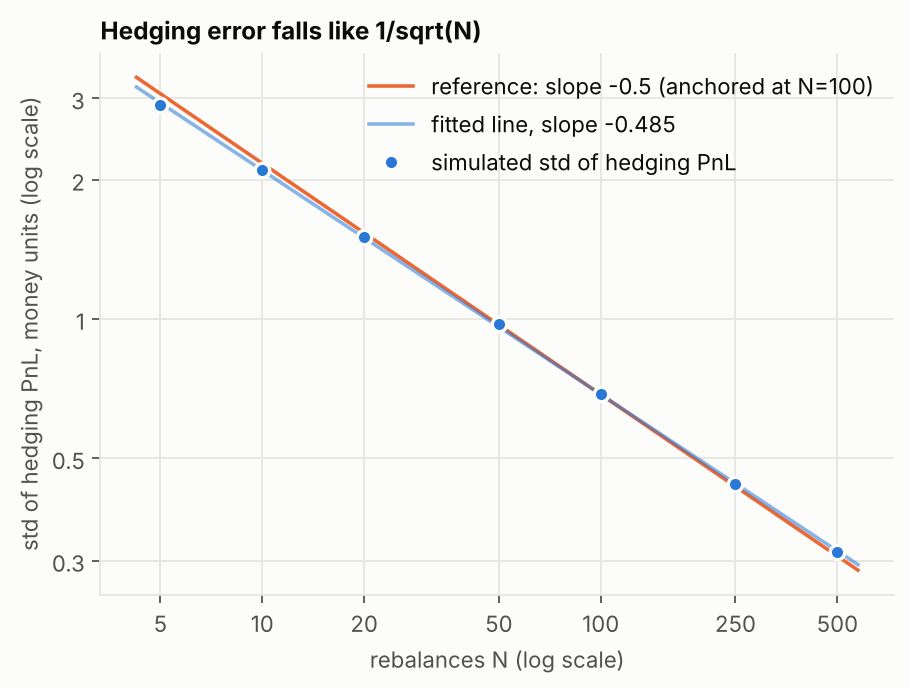

# Discrete Delta-Hedging Error Analysis

[](https://github.com/Fablescript22/delta_hedging_analysis/actions/workflows/ci.yml)

**Problem.** An option seller who hedges the option with the underlying at discrete times, not continuously, is left with a hedging error. This project measures how large that error is and how fast it shrinks as the seller rebalances more often (Monte Carlo on simulated geometric Brownian motion), and then asks what decides whether the seller makes or loses money: theory says it is the gap between the volatility priced into the option and the volatility the market then delivers. That is tested on 2,629 rolling 21-trading-day windows of NIFTY 50 history (2016-01-01 to 2026-10-16), with India VIX as the implied volatility. Python: NumPy, pandas, SciPy, matplotlib.



*Standard deviation of the hedging PnL against the number of rebalances N (simulated, log-log). The orange line is the theoretical slope of -1/2; the fitted slope is -0.485.*

## Three findings

1. **Simulation: the error shrinks like 1/sqrt(N).** The log-log slope of the hedging-error standard deviation against N is -0.485 (theory: -0.5). Rebalancing 100 times more often (N = 5 to 500) cuts the error about 9 times, not 100 times. Mean PnL is zero when implied equals realised volatility, as it must be.
2. **Real data: the sign and size of the income are explained by implied volatility sitting above realised volatility.** India VIX exceeded the volatility realised over the following 21 trading days by 2.5 vol points on average. A *theoretical* seller (Black-Scholes call priced at VIX, hedged in the index) earned +0.289% of the index level per window (95% interval 0.22 to 0.36), profitable in 81% of windows. This is **not** a trading result: see "What this does not show".
3. **The surprise: the textbook regression is weak, and nothing known in advance predicts the PnL.** Theory says PnL tracks the variance gap with a slope of about 0.40; the measured slope is 0.050 with R² 0.27, and it changes a lot with the market regime. The path-wise gamma-PnL approximation explains 92% of the PnL, so the mechanism is right but one realised-volatility number is a poor summary of it. Using only what is known when the option is sold (VIX, trailing volatility) the out-of-sample R² is between -0.060 and +0.023: no predictive skill. The strong fits use the window's own realised path and explain the PnL after the fact.

## Method in brief

Sell an at-the-money call priced by Black-Scholes at the implied volatility; delta-hedge with the underlying at discrete closes with a self-financing cash account; measure the PnL at maturity. Part A simulates GBM (fixed seed 42, 20,000 paths per setting). Part B repeats the procedure on real windows (K = index level at the start, sigma = India VIX/100, daily hedging, PnL as a fraction of the starting index level). Overlapping windows are handled with Newey-West standard errors, block bootstraps, non-overlapping subsamples and chronological calibration/validation/test splits, with calm, drawdown and recovery states, eleven volatility estimators and a calendar-time re-run as robustness checks. Every number in these documents is read from a results file written by an actual run. The work is exploratory: many comparisons are reported and none is corrected for multiple testing.

## What this does not show

- **It is not a profitable options strategy.** The +0.289% per window is the income of a theoretical Black-Scholes option priced from India VIX. There are **no option quotes**, **no futures hedge** (basis, carry, roll), and **no measured transaction costs, spreads or taxes** in the data. India VIX is a 30-day model-free measure built from options across strikes, not an at-the-money implied volatility, so the theoretical income is probably optimistic. Costs appear only as clearly labelled scenarios.
- **A proxy input.** The risk-free rate is the RBI 91-day T-bill yield (mean 5.6%), not the seller's actual financing rate; constant rates from 4% to 8% are tested and move no conclusion.
- **One index, one sample, one extreme episode.** About 125 independent months, with the March 2020 crash (66 windows) driving much of the regression result.
- **In one line:** an investigation of discrete delta-hedging error and of the relationship between theoretical hedging PnL and implied-versus-realised volatility, using Monte Carlo simulation and historical NIFTY 50 / India VIX data.

## Reproduce

```
pip install -r requirements.txt      # or requirements-lock.txt for the exact versions behind the numbers
python -m src reproduce              # regenerate every result, figure and document (each stage in its own process)
python -m src test                   # run the test suite
```

**Getting the data.** The public repository does not include the raw NIFTY 50 and India VIX files or the RBI Treasury-bill tables, because their publishers' terms restrict or do not clearly allow redistribution. Download them yourself (links, file layout and known problems are in [data/raw/SOURCES.md](data/raw/SOURCES.md)): put the 22 NIFTY 50 / India VIX CSV files in `data/raw/`, put the RBI spreadsheets in `data/raw/rbi_xlsx/` and run `python -m src.rates` to build the T-bill file, then run `python -m src check-data`: it compares everything with a SHA-256 manifest and tells you whether they are the files these results came from. Without the files, the tests and stages that need them are skipped or stop with this message, and everything that only needs the committed results (the README, report, figures gallery, data dictionary and the Part A experiments) still works.

Last recorded run: <!--volatile-->last run on Python 3.13.16: validation 13 s / 396 MB; part a 44 s / 450 MB; part b 14 s / 215 MB; gallery 0 s / 17 MB; data dictionary 0 s / 67 MB; computation total 75 s (wall time / peak resident memory per stage; hardware dependent)<!--/volatile-->. Tests: <!--volatile-->14 test files: last recorded run 221 passed, 53 skipped (need the raw data files) (Python 3.13.16)<!--/volatile-->. The CI badge above is the status of the latest run on GitHub (tests on Python 3.11-3.13, plus a full regeneration that fails if any committed table, document or README differs from the regenerated one). `python -m src check-data` verifies the raw files against a SHA-256 manifest.

## Where to read more

| | |
|---|---|
| [docs/RESEARCH_REPORT.md](docs/RESEARCH_REPORT.md) | the full report: theory, data cleaning, all tables, every figure, limitations, validation log |
| [EXPLAINER.md](EXPLAINER.md) | plain-English walkthrough of the code and results |
| [docs/FIGURE_GALLERY.md](docs/FIGURE_GALLERY.md) | all figures with captions |
| [docs/DATA_DICTIONARY.md](docs/DATA_DICTIONARY.md) | every input and results column, with units |
| [data/raw/SOURCES.md](data/raw/SOURCES.md) | data sources, official methodology references, known file problems, terms of use |
| [docs/OPTIONS_EXTENSION_PLAN.md](docs/OPTIONS_EXTENSION_PLAN.md) | plan for the realistic extension (option quotes, futures hedging, measured costs) |

## Licence and data

No licence has been chosen for the code, so by default all rights are reserved: the code can be read, but it has not been licensed for reuse. The raw NIFTY 50 and India VIX files come from NSE Indices and NSE, are subject to their terms (see `data/raw/SOURCES.md`) and are not redistributed here. The per-window results table, which holds the VIX level of every date, is omitted for the same reason; the aggregate tables and figures are included.
