# Figure gallery

Generated by `python -m src.make_gallery`; the images are regenerated by `python -m src reproduce`. The README discusses each figure in context.

## Part A: simulated GBM

### A2_scaling_loglog

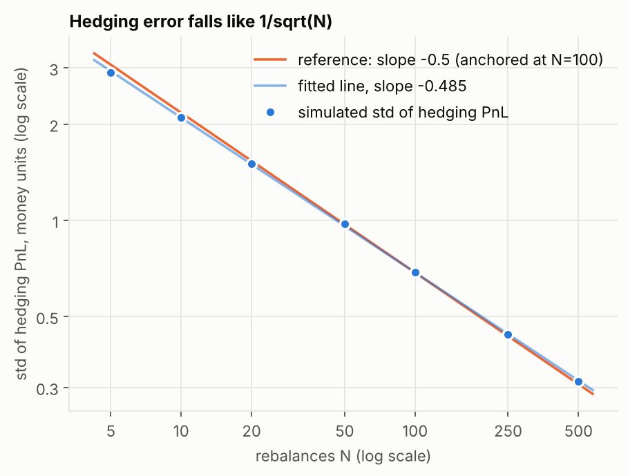

Standard deviation of hedging PnL against the number of rebalances N (log-log), with the exact -1/2 slope for reference.

### A2_pnl_distributions

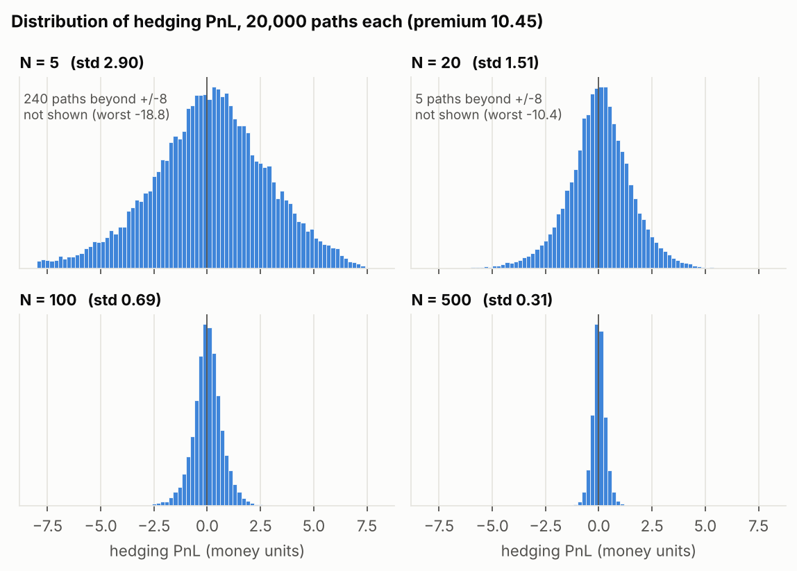

Distribution of hedging PnL for N = 5, 20, 100 and 500: same centre, shrinking spread.

### A3_volgap_mean_pnl

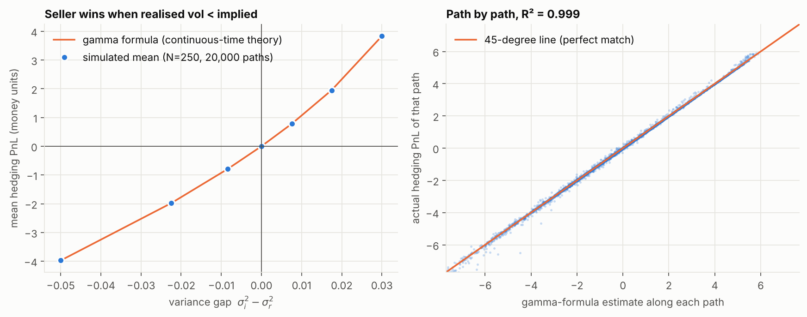

Mean PnL against the volatility gap, simulation against the closed-form expectation.

### A4_costs_and_optimal_N

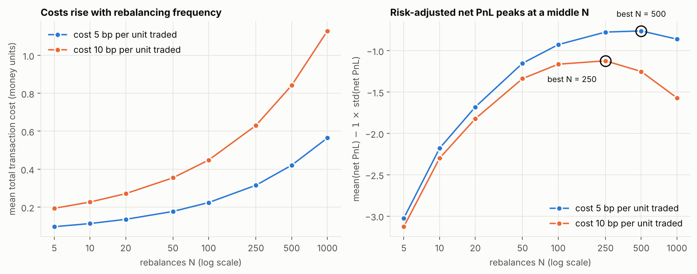

Transaction costs against N, and the risk-penalised net PnL that determines the best N.

## Part B: NIFTY 50 and India VIX

### B1_vix_vs_realised_vol

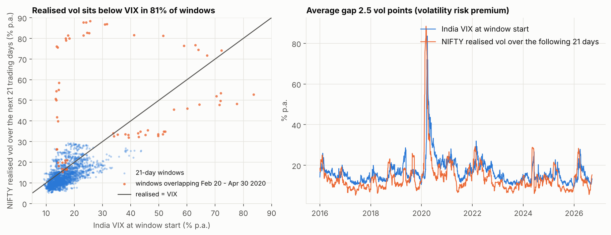

India VIX against realised volatility: the volatility risk premium.

### B2_pnl_vs_variance_gap

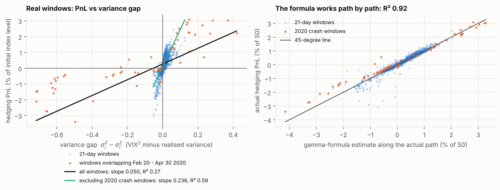

Hedging PnL against the variance gap, with and without the March 2020 crash windows.

### B3_error_vs_rebalancing_interval

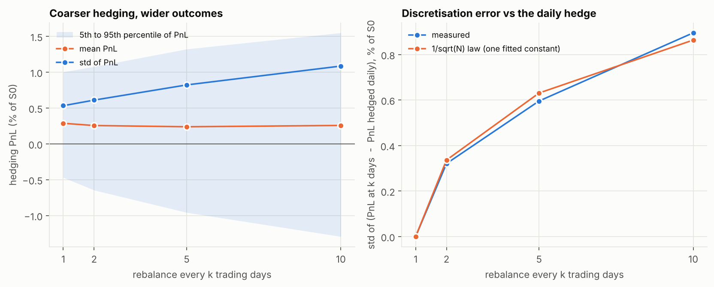

Hedging every 1, 2, 5 and 10 days: spread of PnL and the 1/sqrt(N) test.

### B4_effect_size_intervals

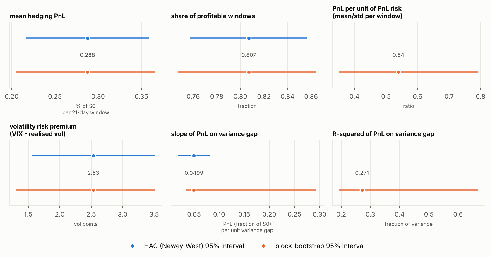

Headline effect sizes with HAC and block-bootstrap 95% intervals.

### B5_market_states

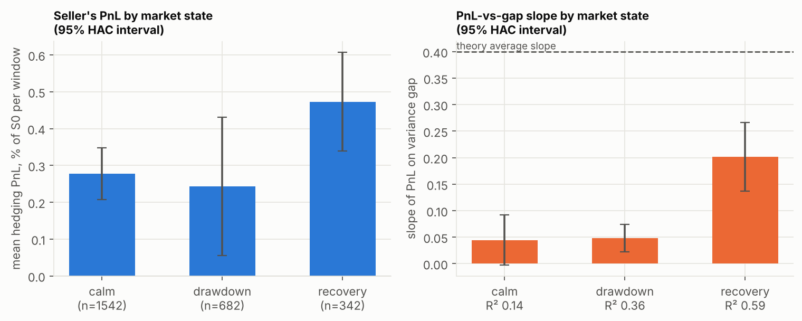

Seller's PnL and the PnL-vs-gap slope in calm, drawdown and recovery states.

### B6_vol_estimators

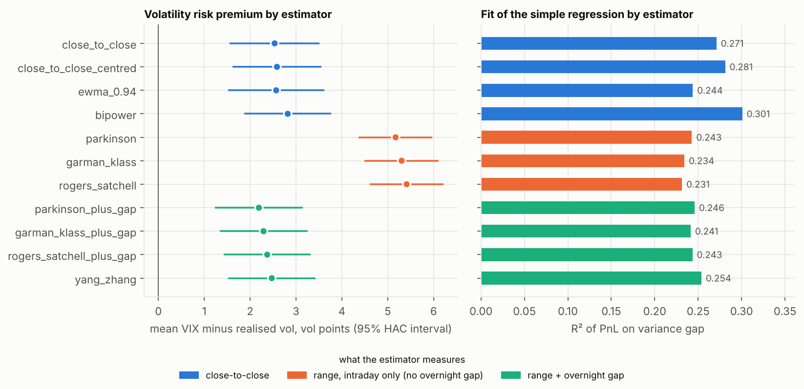

Volatility risk premium and regression fit under eleven volatility estimators, coloured by what they measure (the intraday-only range estimators miss the overnight gap).

### B7_chronological_split

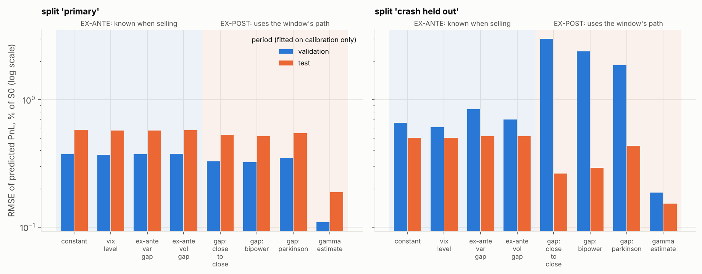

Prediction error on validation and test periods for models fitted on the calibration period: ex-ante models (known when selling) on the left, ex-post models (use the window's own path) on the right.

### B8_friction_scenarios

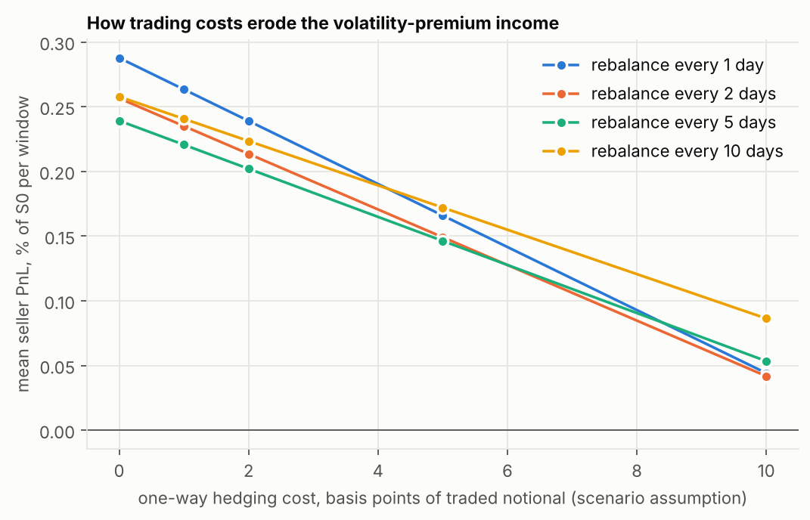

Mean PnL against one-way hedging cost (scenario assumption) for four rebalancing intervals.

